# Paperwake

**A calm, four-colour e-paper display for your home: designed on your own
machine, delivered over your own network, running on a battery.**

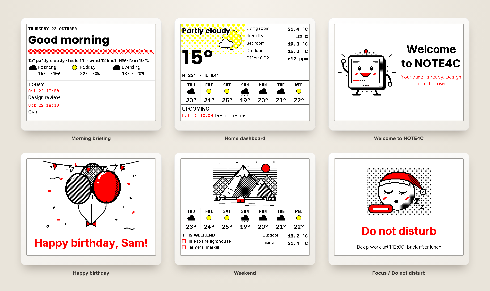

<sub>Every panel image on this page is a real render: the same code that packs
the bytes for the device, run over made-up sample data. No mock-ups.</sub>

Paperwake turns a [ZECTRIX ESP32-S3 e-paper panel](https://wiki.zectrix.com)
(the NOTE4C: 400 × 300, a four-colour black · white · red · yellow panel) into
a quiet display for a desk, a wall or the fridge door. Weather, your agenda,
Home Assistant sensors, a countdown, a picture, a note to the house: composed
in a paper-styled web app on your computer and pushed to the panel over your
LAN.

No cloud. No account. The composer binds to `localhost`, and the panel sleeps
between updates the way e-paper should.

---

## What you get

### An editor where the preview *is* the panel

Drop blocks onto a fine **16 × 12 grid** (25-pixel cells), move and resize
them with the mouse or the keyboard, or press **Auto layout** to re-pack a
composition into tidy rows. *Auto* variants pick the format that suits each
block's size. The canvas is painted by the same deterministic renderer that
produces the device's bytes: same dithering, same pigments, pixel for pixel.

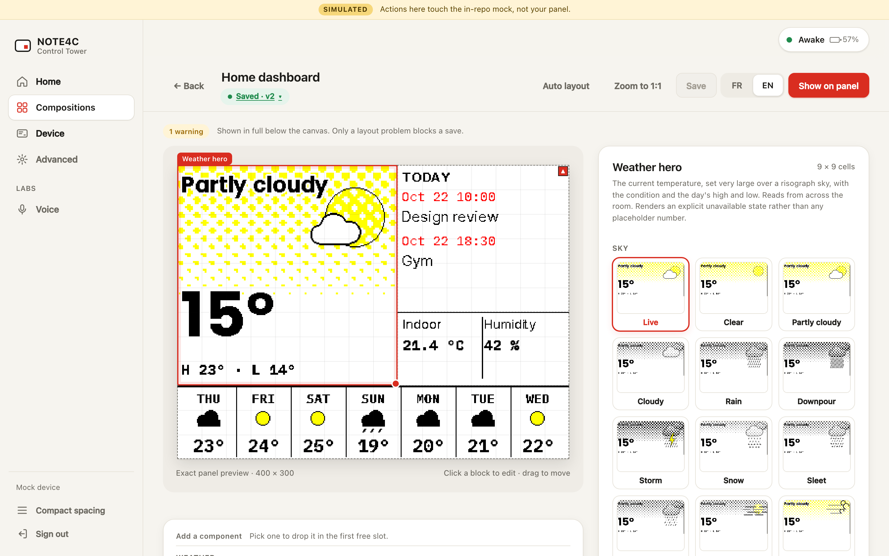

### Blocks

| | |
| --- | --- |
| **Weather** | hero temperature with an illustrated sky · one-line and day-summary formats · next 24 hours · 7-day strip |
| **Time & calendar** | next events from a calendar snapshot · countdown · last updated |
| **Sky** | sunrise, sunset, day length and the moon: pure astronomy, no network |
| **Text** | headline · message · list · a message shown only when your Reminders say so |
| **Home** | Home Assistant `sensor.*` readings, picked from a list |
| **Image** | the built-in CC0 image library, or any picture of your own, dithered to the panel's pigments |

Missing data is drawn as missing: a block never falls back to a zero or an
invented number.

| Weather formats | Home Assistant sensor picker |
| --- | --- |
| 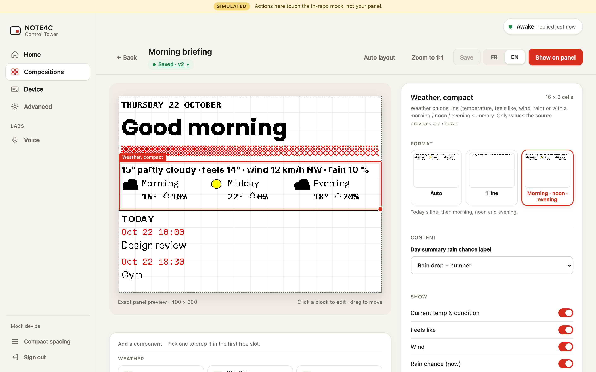 | 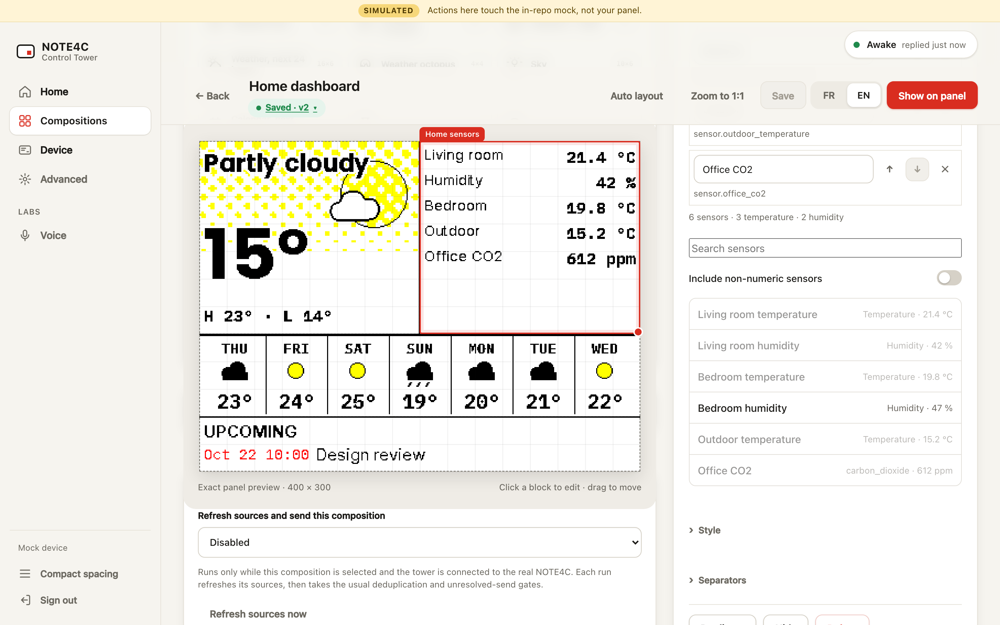 |

### An image library made for this panel

25 original illustrations (a mascot, coffee, birthday balloons,
do-not-disturb, seasonal pictures…), each pre-dithered at several sizes and
released under **CC0**.

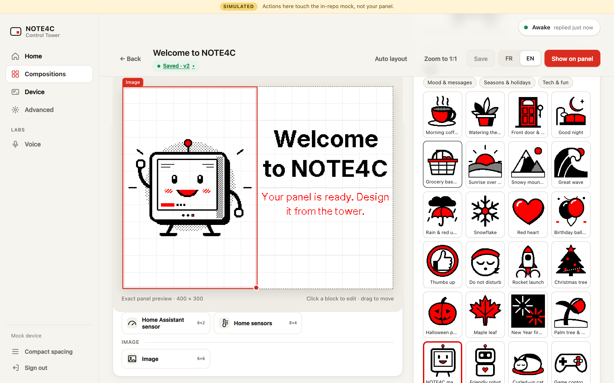

### Panel language: English or French

One switch translates every word the blocks write on the panel: days, months,
weather conditions and empty states. Text you typed yourself is left alone.

### Colour, done carefully

The NOTE4C is a four-colour **BWRY** panel, and Paperwake uses all four inks:
black and white are structural, red is the accent and yellow the highlight
(sun icons, highlights, dithered pictures). Either accent can be switched off,
and the renderer then maps it to an enabled colour. Accents are never dithered
finer than 2 px, so they always print cleanly.

The **Weather hero** draws the sky it describes: eleven scenes, by day and by
night, with the moon at its real phase.

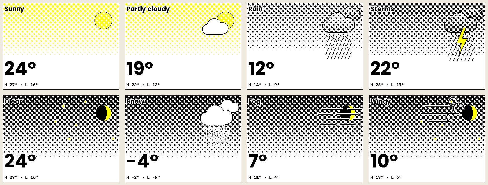

### Honest delivery to a device that is usually asleep

A battery panel spends most of its life in deep sleep with its radio off; no
packet can wake it. So Paperwake never pretends it can:

- A change aimed at a sleeping panel is **queued**, shown as pending, and
  delivered in the short window after the panel's own timer wakes it.
- Every push goes through **Sent → Received → Displayed** in an append-only
  ledger. A frame only counts as displayed once the device reports that exact
  digest back; a missing confirmation is *uncertain*, not failed.
- A frame identical to the one already on the glass is not re-sent.
- Press the panel's **BOOT** button and the composer notices within seconds.

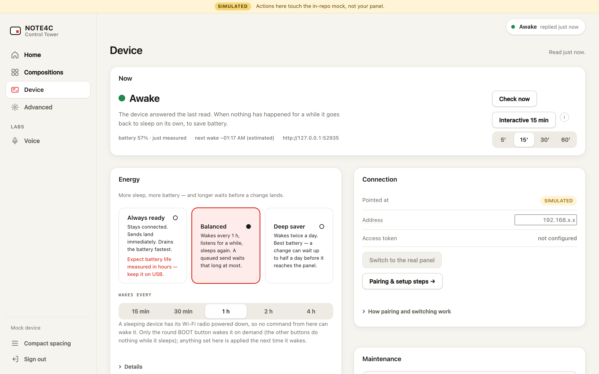

| Home | Compositions | Phone |
| --- | --- | --- |
| 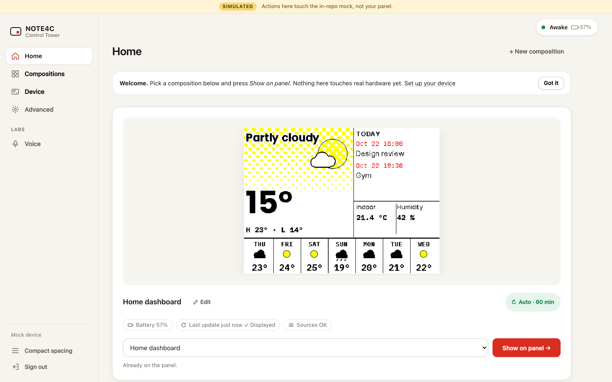 | 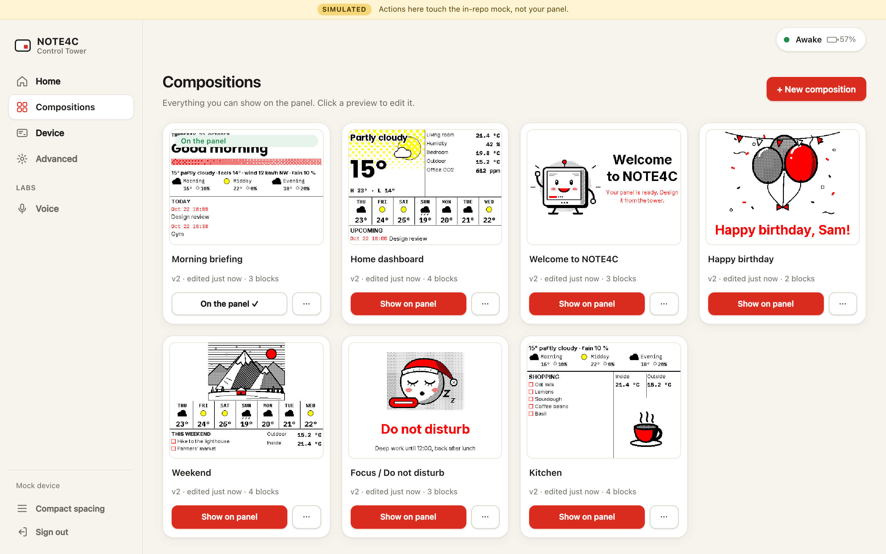 | 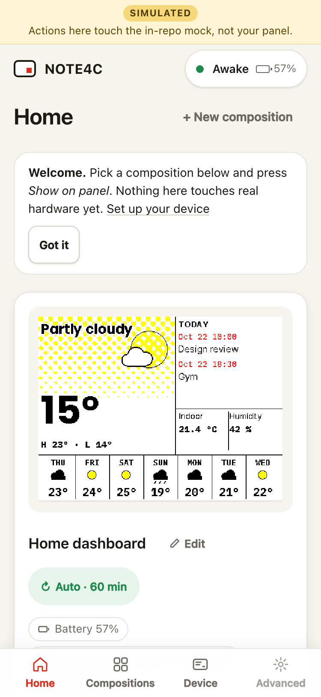 |

---

## Compositions

Seven starting compositions, rendered by the real panel renderer (2×,
nearest-neighbour):

| | | |
| --- | --- | --- |
| 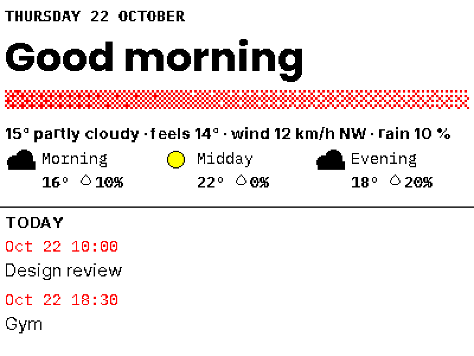 **Morning briefing** | 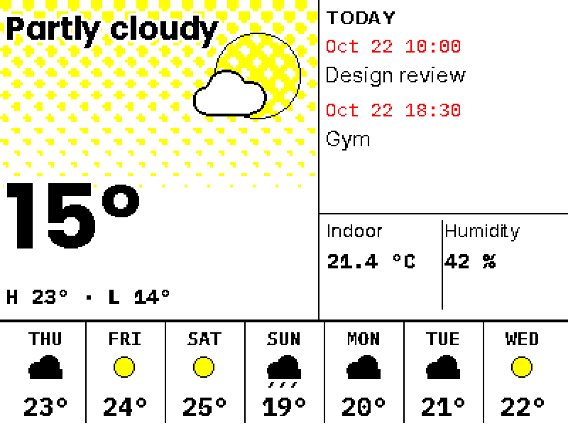 **Home dashboard** |  **Welcome** |
| 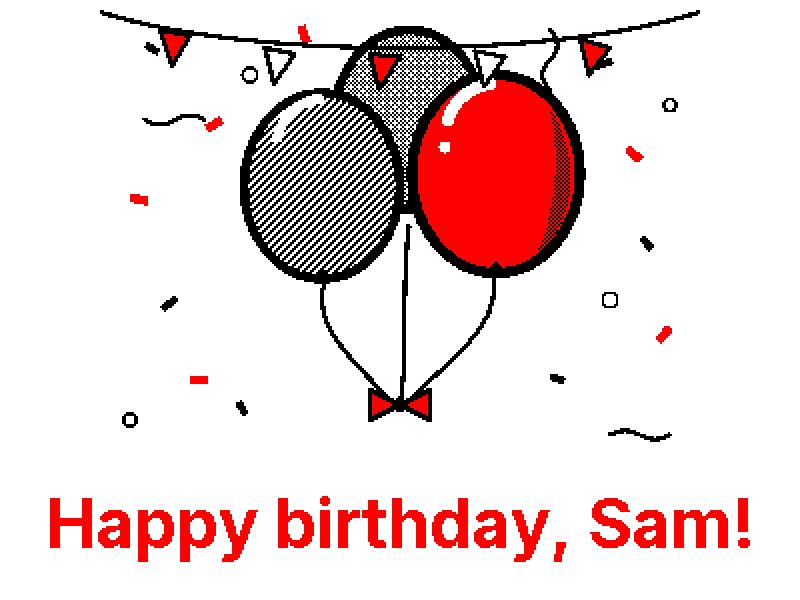 **Happy birthday** | 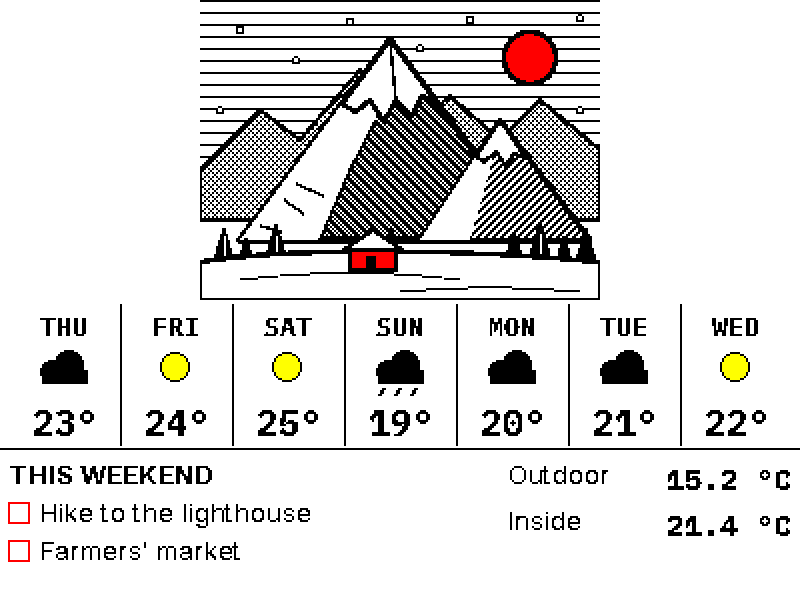 **Weekend** | 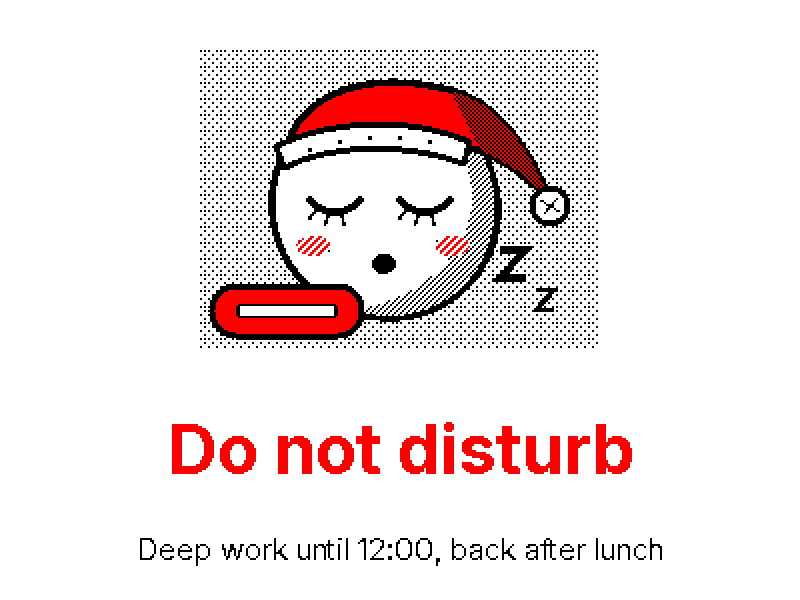 **Focus / Do not disturb** |
| 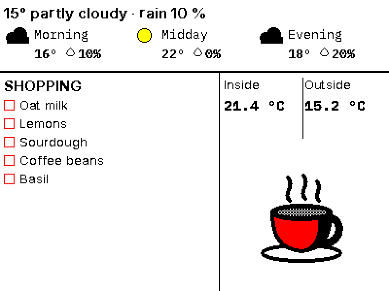 **Kitchen** | | |

Regenerate every picture with `npm run screenshots:all` in `control-tower/`;
it uses fixture data only.

---

## How it works

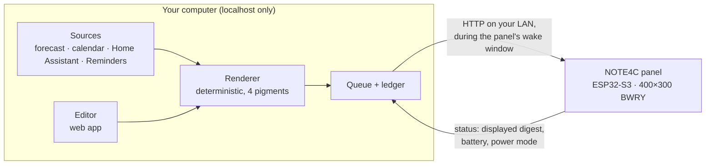

1. **Sources** are read on your machine (an Open-Meteo forecast for
   coordinates you set, a calendar snapshot, Home Assistant sensors, Reminders
   counts) and only for blocks a composition actually uses.
2. **The renderer** turns a composition into a 30 000-byte frame. The browser
   preview runs the same TypeScript.
3. **The panel** wakes on its own timer (every 15 minutes up to twice a day,
   your choice); the composer catches that window, delivers, confirms, and the
   panel goes back to sleep.

---

## Try it in two minutes, no hardware needed

A faithful mock of the panel ships in the repo, so you can run the whole thing
without a device (Node 20+):

```bash
git clone https://github.com/alexclmy/Paperwake.git
cd Paperwake/control-tower
npm install
npm run dev          # → http://localhost:8654
```

Set a passphrase on first run, pick a starting composition, press **Show on
panel**. Everything the mock returns is labelled `SIMULATED`.

When you have a panel, [`control-tower/QUICKSTART.md`](control-tower/QUICKSTART.md)
walks through pairing and the first real push.

---

## What's in this repository

| | What it is | Stack |
| --- | --- | --- |
| [**`control-tower/`**](control-tower/) | The composer: editor, renderer, sources, delivery queue, device page. Runs on your machine. | Next.js, TypeScript |
| [**`firmware/`**](firmware/) | What runs on the panel: render pipeline, LAN API, power management, the on-device UI. | ESP-IDF (C/C++), ESP32-S3 |

Go deeper:

- [Control tower README](control-tower/README.md): configuration, architecture, development
- [Architecture](control-tower/docs/ARCHITECTURE.md): how a pixel gets from a source to the glass
- [Design language](control-tower/docs/DESIGN-LANGUAGE.md): the dithering engine and the editor's UX
- [Compatibility](control-tower/docs/COMPATIBILITY.md): which panels and firmware levels have been tried
- [Firmware](firmware/README.md): building, flashing, the device API
- [Security](control-tower/SECURITY.md): what can leave your machine, and what never does

---

## Principles

- **Local-first.** The composer binds `localhost`; the panel must be a private
  LAN address. Every outbound request (forecast, Home Assistant…) is off until
  you configure it, and all of them are read-only. No telemetry, no
  third-party assets in the browser.
- **The preview is the renderer.** One pipeline, byte-identical in the browser
  and on the device.
- **Never a zero in place of missing data.** `uncertain` is not `failed`; a
  stale forecast says it is stale.

---

## Status

A working, personal project, running on one panel at home.

Exercised on real hardware: pushes confirmed on the glass; battery operation
with timer wakes caught and delivered to autonomously; button wakes; the
push-to-talk voice path end to end. Not yet: more than one panel, more than
one home network, or a measured battery-life figure (this project publishes
none). The [compatibility notes](control-tower/docs/COMPATIBILITY.md) are the
honest limit of what has been tried.

## Provenance

The firmware is a consolidated fork of an upstream ESP32-S3 e-paper project;
its lineage, base revision and build hashes are documented in
[`firmware/ATTRIBUTION.md`](firmware/ATTRIBUTION.md) and
[`firmware/PROVENANCE-MANIFEST.md`](firmware/PROVENANCE-MANIFEST.md). The
composer and its image library are original work.

## Author

Built by [**@alexclmy**](https://github.com/alexclmy). Say hi on Twitter/X:
[**@ytiralugins**](https://x.com/ytiralugins).

## License

[MIT](LICENSE). The image library (`control-tower/assets/image-library/`,
`control-tower/src/core/library/art/`) is **CC0 1.0**, see
[its LICENSE](control-tower/assets/image-library/LICENSE). The firmware keeps
its upstream copyright notice in [`firmware/LICENSE`](firmware/LICENSE)
alongside this project's; see `firmware/ATTRIBUTION.md`.

---

<sub>Paperwake is an **unofficial**, personal project. It is not affiliated
with, endorsed by, or supported by the panel's vendor.</sub>
